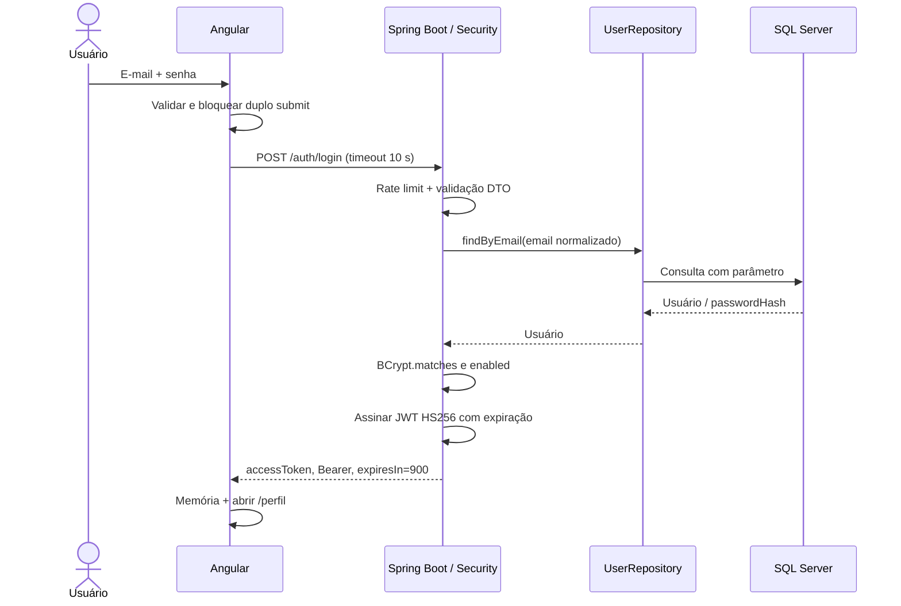
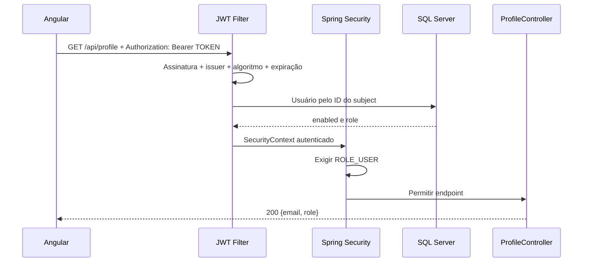

# Guia para criação da apresentação

Este documento é autocontido e descreve a implementação real da Atividade 5. Pode ser usado por outra IA para criar slides. Não apresente itens pendentes como se tivessem sido executados. Não inclua credenciais, hashes completos ou tokens reais nos slides.

## 1. Contexto da atividade

Disciplina: Programação para Aplicações Web. Atividade: implementar a autenticação da tela de login no servidor com JWT e apresentar conceito + solução em no máximo 30 minutos, submetendo o link do repositório e a apresentação. Equipes de até cinco pessoas.

A Atividade 4 já tinha uma tela Angular com e-mail, senha e botão ENTRAR; o método apenas imprimia os campos no console. A Atividade 5 preservou esse frontend e acrescentou autenticação real no backend.

## 2. Objetivo

Usuário informa e-mail/senha → Angular chama POST /auth/login → Spring busca usuário e verifica BCrypt → servidor retorna JWT → Angular usa Authorization Bearer em chamadas protegidas. A senha não é reenviada a cada consulta.

## 3. Problema resolvido

A interface isolada não verificava identidade e expunha senha no console. Agora existe contrato HTTP, persistência SQL Server, hash, assinatura/expiração de token, autorização no servidor, mensagens amigáveis e uma página de perfil para demonstrar acesso protegido.

Autenticação responde “quem é o usuário?”; autorização responde “o que ele pode acessar?”. ROLE_USER permite GET /api/profile.

## 4. Tecnologias utilizadas

| Camada | Implementação |
|---|---|
| Frontend | Angular 22.1.6 standalone; FormsModule/ngModel preservados; HttpClient; Router; signals; RxJS |
| Build frontend | CLI/build 22.1.8, TypeScript 6.0.3, npm e lockfile |
| Backend | Spring Boot 3.5.16, Java alvo 21, Spring Web, Security, Data JPA, Bean Validation |
| Autenticação | JJWT 0.12.6, HS256, BCrypt custo 12 |
| Banco | Microsoft SQL Server; driver JDBC Microsoft; Flyway core + módulo SQL Server |
| Build/testes | Maven Wrapper 3.3.4, Maven 3.9.11; JUnit, MockMvc e Mockito |

Não existem OAuth2, refresh token, Redis, microserviços, cadastro ou recuperação de senha. O backend está em backend/ no mesmo repositório; Angular continua na raiz. A única nova dependência frontend é @angular/router@22.1.6.

## 5. Arquitetura

```text
Navegador — Angular (porta 4200)
    ↓ HTTP JSON / Authorization Bearer
Spring Boot (porta 8080)
    ↓ SecurityFilterChain → filtros → controller → service
Spring Data JPA / JDBC
    ↓ consulta parametrizada
SQL Server (porta 1433 na configuração proposta)
```

Estrutura: src/app/login (formulário original), auth (serviço/interceptor/guard), profile (demonstração), app.config.ts e app.routes.ts. Backend: config, controller, dto, entity, exception, repository, security e service, sob backend/src/main/java/br/uesc/login. Migration em backend/src/main/resources/db/migration/V1__create_users.sql.

## 6. Fluxo completo do login



Depois do login:



## 7. Fluxo detalhado

1. Formulário valida e-mail obrigatório/válido e senha obrigatória, máximo 72 bytes UTF-8.
2. isLoading bloqueia novas chamadas; o botão mostra ENTRANDO... e é desabilitado.
3. AuthService envia somente email/password ao login. O interceptor não adiciona token nessa rota.
4. LoginRateLimitFilter conta todas as tentativas: 10 por IP em 60 segundos. A 11ª recebe 429/Retry-After.
5. AuthController recebe DTO, não entidade. Bean Validation executa novamente no servidor.
6. AuthenticationService normaliza e-mail para minúsculas e usa Repository parametrizado.
7. BCrypt.matches compara com hash. Se não existir usuário, compara com hash fictício para reduzir diferença temporal. Senha errada, usuário inexistente ou desabilitado: mesma mensagem 401.
8. JwtService cria claims iss/sub/iat/exp. Subject é o ID; senha e hash ficam fora do JWT.
9. Chave vem de JWT_SECRET (Base64 de pelo menos 32 bytes aleatórios). HS256 assina; duração padrão 15 minutos.
10. Angular armazena token somente na memória, limpa a senha e navega para /perfil.
11. AuthGuard facilita navegação. O interceptor só envia o token à origem exata da API em caminhos /api/.
12. O filtro valida JWT, consulta usuário atual e coloca principal/ROLE_USER no SecurityContext.
13. SecurityFilterChain verifica autorização. Perfil retorna e-mail e role, sem hash.
14. Expiração gera 401 no servidor; Angular limpa o token e retorna ao login. Reload também exige login; logout não revoga cópias do token.

Contrato:

- POST /auth/login: entrada `{"email":"aluno@example.com","password":"<senha escolhida>"}`.
- Sucesso: `{"accessToken":"<JWT>","tokenType":"Bearer","expiresIn":900}`.
- GET /api/profile: exige Bearer e ROLE_USER; retorna `{"email":"aluno@example.com","role":"ROLE_USER"}`.
- 400 entrada inválida; 401 não autenticado; 403 sem permissão (também usado na rejeição CORS); 429 excesso; 500 erro interno genérico.

Banco: app_users com id BIGINT IDENTITY, email VARCHAR(254) único, password_hash VARCHAR(60), role VARCHAR(20), enabled BIT, created_at DATETIME2(6). Flyway cria a tabela; Hibernate valida o esquema. DemoUserInitializer cria usuário opt-in a partir de variáveis, com BCrypt, sem sobrescrever um e-mail existente.

## 8. Código fundamental

Os blocos abaixo foram extraídos dos arquivos finais. São trechos reais, não arquivos completos; imports e trechos intermediários podem estar omitidos.

### 1. LoginRequest

```java
public record LoginRequest(
        @NotBlank @Email @Size(max = 254) String email,
        @NotBlank @Size(max = 72) String password) {
```

#### O que esse código faz?

Define o corpo do login com obrigatoriedade, formato de e-mail e limites.

#### Por que ele é importante?

Validação no servidor não depende de o cliente Angular se comportar corretamente. O arquivo também valida o limite de 72 bytes UTF-8 do BCrypt.

#### Em qual arquivo está?

`backend/src/main/java/br/uesc/login/dto/LoginRequest.java`

### 2. LoginResponse

```java
public record LoginResponse(String accessToken, String tokenType, long expiresIn) {
```

#### O que esse código faz?

Define os três campos devolvidos ao frontend.

#### Por que ele é importante?

O contrato entrega token/tipo/validade e não devolve senha ou entidade JPA.

#### Em qual arquivo está?

`backend/src/main/java/br/uesc/login/dto/LoginResponse.java`

### 3. AuthController

```java
    @PostMapping("/login")
    public LoginResponse login(@Valid @RequestBody LoginRequest request) {
        return authentication.login(request);
    }
```

#### O que esse código faz?

Recebe POST /auth/login, valida o DTO e delega ao service.

#### Por que ele é importante?

Mantém o controller pequeno; regras de autenticação não ficam misturadas à camada HTTP.

#### Em qual arquivo está?

`backend/src/main/java/br/uesc/login/controller/AuthController.java`

### 4. AuthenticationService

```java
        AppUser user = users.findByEmail(request.email().trim().toLowerCase(Locale.ROOT)).orElse(null);
        String hash = user == null ? dummyHash : user.getPasswordHash();
        boolean matches = encoder.matches(request.password(), hash);
        if (user == null || !matches || !user.isEnabled()) {
            throw new BadCredentialsException("Email ou senha inválidos.");
        }
```

#### O que esse código faz?

Busca usuário, compara BCrypt e rejeita credenciais inválidas ou usuário desabilitado.

#### Por que ele é importante?

A mesma mensagem reduz enumeração de usuários; o hash fictício evita pular completamente BCrypt quando o e-mail não existe.

#### Em qual arquivo está?

`backend/src/main/java/br/uesc/login/service/AuthenticationService.java`

### 5. BCryptPasswordEncoder

```java
    @Bean
    PasswordEncoder passwordEncoder() { return new BCryptPasswordEncoder(12); }
```

#### O que esse código faz?

Configura BCrypt custo 12 como implementação de PasswordEncoder.

#### Por que ele é importante?

A mesma estratégia é usada para gerar e verificar o hash; o custo torna tentativas de adivinhação mais caras.

#### Em qual arquivo está?

`backend/src/main/java/br/uesc/login/config/SecurityConfig.java`

### 6. Geração de JWT

```java
        return Jwts.builder()
                .issuer(ISSUER)
                .subject(userId.toString())
                .issuedAt(Date.from(now))
                .expiration(Date.from(now.plusSeconds(properties.ttlSeconds())))
                .signWith(key, Jwts.SIG.HS256)
                .compact();
```

#### O que esse código faz?

Cria emissor, subject, emissão e expiração e assina com HS256.

#### Por que ele é importante?

Token possui validade limitada e integridade verificável; o subject contém apenas o ID.

#### Em qual arquivo está?

`backend/src/main/java/br/uesc/login/security/JwtService.java`

### 7. Validação do JWT

```java
        Jws<Claims> parsed = Jwts.parser()
                .verifyWith(key)
                .requireIssuer(ISSUER)
                .clock(() -> Date.from(clock.instant()))
                .build()
                .parseSignedClaims(token);
        if (!"HS256".equals(parsed.getHeader().getAlgorithm())) {
            throw new JwtException("Algoritmo não permitido.");
        }
        Claims claims = parsed.getPayload();
        if (claims.getExpiration() == null || claims.getIssuedAt() == null) {
            throw new JwtException("Claims obrigatórias ausentes.");
        }
```

#### O que esse código faz?

Verifica assinatura, emissor, expiração, algoritmo e claims obrigatórias.

#### Por que ele é importante?

Decodificar Base64 não basta. O servidor só aceita tokens criptograficamente válidos e ainda vigentes.

#### Em qual arquivo está?

`backend/src/main/java/br/uesc/login/security/JwtService.java`

### 8. SecurityFilterChain

```java
                .authorizeHttpRequests(auth -> auth
                        .requestMatchers(HttpMethod.POST, "/auth/login").permitAll()
                        .requestMatchers(HttpMethod.GET, "/api/profile").hasRole("USER")
                        .anyRequest().denyAll())
```

#### O que esse código faz?

Libera somente o login e exige ROLE_USER no perfil; nega outras rotas.

#### Por que ele é importante?

Essa é a autorização real, aplicada inclusive a clientes que ignoram o Angular. A mesma configuração declara STATELESS e explica CSRF.

#### Em qual arquivo está?

`backend/src/main/java/br/uesc/login/config/SecurityConfig.java`

### 9. JWT Filter e SecurityContext

```java
                Long id = jwt.validateAndGetUserId(header.substring(7));
                AppUser user = users.findById(id).filter(AppUser::isEnabled)
                        .orElseThrow(() -> new JwtException("Usuário indisponível."));
                var authorities = List.of(new SimpleGrantedAuthority("ROLE_" + user.getRole()));
                var authentication = new UsernamePasswordAuthenticationToken(user.getEmail(), null, authorities);
                SecurityContextHolder.getContext().setAuthentication(authentication);
```

#### O que esse código faz?

Usa o token validado para buscar usuário ativo e montar a autenticação da requisição.

#### Por que ele é importante?

A role é a atual do banco; o filtro não armazena senha nem confia na UI.

#### Em qual arquivo está?

`backend/src/main/java/br/uesc/login/security/JwtAuthenticationFilter.java`

### 10. UserRepository

```java
    // Spring Data usa parâmetros; a entrada não é concatenada em SQL.
    Optional<AppUser> findByEmail(String email);
```

#### O que esse código faz?

Declara busca por e-mail através do Spring Data.

#### Por que ele é importante?

A entrada é um parâmetro, não uma parte concatenada do comando SQL.

#### Em qual arquivo está?

`backend/src/main/java/br/uesc/login/repository/UserRepository.java`

### 11. AuthService Angular

```typescript
  login(email: string, password: string) {
    return this.http.post<LoginResponse>(`${API_BASE_URL}/auth/login`, { email, password }).pipe(
      timeout(LOGIN_TIMEOUT_MS),
      tap(response => {
        this.clearSession();
        this.expiresAt = Date.now() + response.expiresIn * 1000;
        this.accessToken.set(response.accessToken);
        this.expirationTimer = setTimeout(() => this.expireSession(), response.expiresIn * 1000);
      }),
    );
  }
```

#### O que esse código faz?

Envia credenciais, define timeout, salva token em memória e agenda expiração.

#### Por que ele é importante?

O componente não controla detalhes HTTP ou persistência do token. Reload encerra o acesso local.

#### Em qual arquivo está?

`src/app/auth/auth.service.ts`

### 12. Interceptor Angular

```typescript
  const url = new URL(request.url, window.location.origin);
  const api = new URL(API_BASE_URL);
  const isProtectedApi = url.origin === api.origin && url.pathname.startsWith('/api/');
  if (!isProtectedApi) return next(request);

  const auth = inject(AuthService);
  const token = auth.getToken();
  const authenticatedRequest = token
    ? request.clone({ setHeaders: { Authorization: `Bearer ${token}` } })
    : request;
```

#### O que esse código faz?

Verifica origem/caminho e só então adiciona Authorization Bearer.

#### Por que ele é importante?

Evita enviar o JWT no login ou para servidores externos; o restante do arquivo trata 401.

#### Em qual arquivo está?

`src/app/auth/auth.interceptor.ts`

### 13. Prevenção de duplo submit

```typescript
    if (this.isLoading()) return;
    this.error.set('');
```

#### O que esse código faz?

Interrompe um novo envio enquanto a requisição anterior estiver ativa.

#### Por que ele é importante?

Junto do botão desabilitado e do finalize, impede cliques acidentais duplicados sem travar a tela após erro.

#### Em qual arquivo está?

`src/app/login/login.ts`

### 14. Timeout RxJS

```typescript
      timeout(LOGIN_TIMEOUT_MS),
```

#### O que esse código faz?

Interrompe a espera do login após 10.000 ms, valor de api.config.ts.

#### Por que ele é importante?

Evita espera indefinida; o componente trata TimeoutError e reabilita o formulário. Não garante cancelamento do trabalho no servidor.

#### Em qual arquivo está?

`src/app/auth/auth.service.ts`

### 15. Rate limit

```java
        long retryAfter = limiter.retryAfter(request.getRemoteAddr());
        if (retryAfter > 0) {
            response.setHeader("Retry-After", Long.toString(retryAfter));
            errors.write(response, 429, "Muitas tentativas. Aguarde um minuto e tente novamente.");
            return;
        }
```

#### O que esse código faz?

Consulta o contador por IP e devolve 429/Retry-After ao exceder a cota.

#### Por que ele é importante?

Dificulta excesso de tentativas. O contador é de janela fixa local; não há Redis ou bloqueio permanente.

#### Em qual arquivo está?

`backend/src/main/java/br/uesc/login/security/LoginRateLimitFilter.java`

## 9. Segurança para explicar na apresentação

| Tema | Explicação ligada à implementação |
|---|---|
| Senha pura | Vazamento de banco exporia o segredo original. A tabela armazena somente password_hash. |
| BCrypt | Hash com salt e custo 12; encode na criação, matches no login; limite 72 bytes UTF-8 evita truncamento/erro. |
| JWT assinado | HS256 detecta alteração do conteúdo. Não é criptografia do payload. |
| Expiração | 900 segundos por padrão; servidor rejeita expirado, cliente limpa memória e exige login. |
| Ambiente | JWT_SECRET/DB_PASSWORD/DEMO_USER_PASSWORD não são fixados no código. .env.example não traz segredos. |
| SQL Injection | findByEmail usa parâmetro JPA. Não há SQL concatenado nem filtro de palavras proibidas. |
| Rate limit | 10 tentativas por IP/60 s; 429/Retry-After; memória limitada a 10.000 IPs; local a uma instância. |
| Validação | Angular para UX; Bean Validation no servidor para proteção independente do cliente. |
| Timeout | 10 segundos na chamada Angular. Banco tem timeout de pool 5 s, validação 3 s e query JPA 5 s; URL de exemplo usa login 5 s/socket 10 s. |
| Múltiplos submits | Guarda isLoading + botão/campos desabilitados + finalize. |
| CORS | Uma origem: localhost:4200, configurável. Controla acesso no navegador; não autentica clientes externos. |
| CSRF | Desabilitado para API stateless sem cookies/Basic; Bearer é enviado explicitamente. Mudar para cookie exige rever o desenho. |
| 401 e 403 | 401: falta autenticação válida. 403: autenticado, mas sem permissão. Origem CORS rejeitada também recebe 403. |
| Armazenamento | Memória somente; sem localStorage/sessionStorage/cookie. Reload exige login; XSS continua sendo risco. |
| Guard | Apenas UX/navegação. A API sempre passa pelo Spring Security mesmo via Postman. |
| Erros e logs | Mensagens genéricas, sem SQL/stack traces na resposta; código não registra senha/hash/token. Headers de segurança padrão mantidos. |

Limites: não há refresh token, revogação no logout, chave rotacionada automaticamente ou rate limit distribuído. Quem copiar um token poderá usá-lo até expirar enquanto o usuário permanecer habilitado. HTTPS é necessário fora do laboratório; o servidor local não configura TLS.

## 10. Preparação e roteiro de demonstração

### Preparação antes da aula

- Configure JDK 21, Node compatível, SQL Server TCP/autenticação SQL e variáveis.
- DB_URL de laboratório: jdbc:sqlserver://localhost:1433;databaseName=atividade5;encrypt=true;trustServerCertificate=true;loginTimeout=5;socketTimeout=10000.
- Defina DB_USERNAME/DB_PASSWORD; para Compose defina MSSQL_SA_PASSWORD.
- Gere JWT_SECRET com pelo menos 32 bytes aleatórios codificados em Base64. Não mostre seu valor.
- Defina DEMO_USER_ENABLED=true, DEMO_USER_EMAIL=aluno@example.com e uma senha escolhida de pelo menos 12 caracteres (máximo 72 bytes UTF-8).
- No Compose: docker compose up -d sqlserver; depois docker compose run --rm db-init. Em instância própria, crie o banco vazio atividade5.
- Backend: em backend/, execute .\mvnw.cmd spring-boot:run.
- Angular: na raiz, npm ci e npm start. Navegador: http://localhost:4200.
- Spring não carrega .env automaticamente; defina as variáveis no terminal/IDE. Compose lê .env.
- Confirme login antes da apresentação e tenha capturas sem dados sensíveis como contingência.

### Demonstração ao vivo sugerida — 5 minutos

1. Mostre o diagrama e as três camadas.
2. Mostre tabela app_users: id, email, role e enabled.
3. Mostre só o prefixo BCrypt com `SELECT email, LEFT(password_hash, 7) AS bcrypt_prefix FROM app_users;`. Explique salt/custo e evite projetar hash completo.
4. Abra Angular e confirme que o layout da Atividade 4 foi mantido.
5. Envie credenciais erradas; mostre mensagem genérica e HTTP 401 no Network.
6. Faça login correto; mostre os campos accessToken/tokenType/expiresIn. Oculte o valor do token na gravação/slides.
7. Mostre GET /api/profile e a existência do header Authorization Bearer. A senha não aparece nessa requisição.
8. Mostre a página autenticada e o botão Atualizar perfil.
9. Em cliente HTTP, chame o perfil sem header e com Bearer inválido; mostre 401.
10. Use Sair e tente /perfil; mostre retorno ao login pelo guard, explicando que a API também bloqueia.
11. Opcional: 11 tentativas no mesmo IP em menos de um minuto → 429. Reserve a demonstração de rate limit para o final para não bloquear o próprio login.
12. Opcional: JWT_TTL_SECONDS=60, novo login e espera → expiração. Não afirme que mudar TTL encurta tokens emitidos anteriormente.

## 11. Estrutura sugerida dos slides

16 slides, **24 minutos de conteúdo/demonstração + 2 minutos para perguntas = 26 minutos**, abaixo do limite de 30 minutos. As durações incluem as transições.

| # | Título | Objetivo | Conteúdo | Código/diagrama recomendado | Pontos a explicar | Tempo |
|---|---|---|---|---|---|---|
| 1 | Autenticação JWT — Atividade 5 | Apresentar trabalho/equipe | Disciplina, integrantes, objetivo | Título e tecnologias | Evolução da Atividade 4 | 0,5 min |
| 2 | Contexto e problema | Justificar backend | Antes: formulário/logs; agora: validação no servidor | Fluxo textual curto | Interface sozinha não autentica | 1 min |
| 3 | Autenticação x autorização | Separar conceitos | Identidade x permissão; USER | Login e perfil | 401 x 403 | 1 min |
| 4 | Por que não salvar senha pura? | Explicar proteção da senha | Hash, salt, custo e BCrypt | Trecho 5 e campo password_hash | Não é criptografia reversível; limite de bytes | 1 min |
| 5 | O que é JWT? | Explicar token | Header/payload/assinatura; sub/iat/exp/iss | JWT esquemático sem token real | Assinado, legível e temporário | 1,5 min |
| 6 | Arquitetura | Situar camadas | Angular, Spring Security, JPA, SQL Server | Diagrama da seção 5 | Angular na raiz/backend separado | 1 min |
| 7 | Fluxo de login | Explicar ponta a ponta | DTO, service, BCrypt, resposta | SequenceDiagram e trechos 1–4 | Senha somente no login | 1,5 min |
| 8 | Banco e usuário de demonstração | Mostrar persistência | Tabela única, Flyway, initializer | Esquema e trecho 10 | E-mail único, hash, opt-in, sem sobrescrever | 1,5 min |
| 9 | Geração e validação JWT | Mostrar integridade/tempo | HS256, segredo de ambiente, 900 s | Trechos 6–7 | Nunca incluir senha; alterar payload invalida assinatura | 1,5 min |
| 10 | Spring Security | Mostrar regras reais | Stateless, público/privado, ROLE_USER | Trecho 8 | Guard não substitui SecurityFilterChain | 1,5 min |
| 11 | JWT Filter | Explicar requisição protegida | Bearer → validação → usuário → contexto | Trecho 9 e segundo diagrama | Credenciais nulas, role atual do banco | 1,5 min |
| 12 | Integração Angular | Mostrar evolução da UI | Serviço, interceptor, guard, memória | Trechos 11–14 | Origem restrita, timeout, loading, logout/reload | 1,5 min |
| 13 | Proteções e limites | Demonstrar escolhas conscientes | Validação, JPA, CORS, CSRF, rate limit | Trecho 15 e tabela de segurança | 429, XSS, logout sem revogação | 2 min |
| 14 | Demonstração | Evidenciar funcionamento | Login errado/correto, Bearer, perfil, 401 | Navegador + Network + cliente HTTP | Não expor segredos; usar roteiro da seção 10 | 5 min |
| 15 | Testes e evidências | Distinguir prova e pendência | Builds, 25 testes, migration real | Resumo Maven/Angular sem tokens | Repositório simulado; integração completa pendente na entrega | 1 min |
| 16 | Conclusão e próximos passos | Encerrar com o que foi entregue | Fluxo implementado, limites, repositório | Link do repositório da equipe | Slides e publicação são etapas posteriores | 1 min |

Ajuste o slide 15 somente após executar o roteiro real. Não mude “pendente” para “testado” sem evidência. Acrescente os nomes da equipe e o link final na produção dos slides.

## 12. Perguntas que o professor pode fazer

| Pergunta | Resposta baseada nesta implementação |
|---|---|
| O que é autenticação? | Verificar identidade; aqui, e-mail/senha com BCrypt no login e JWT válido nas chamadas seguintes. |
| O que é autorização? | Verificar permissão; aqui, ROLE_USER para acessar o perfil. |
| Qual diferença entre elas? | Um usuário pode estar identificado e ainda não possuir a authority necessária. |
| Por que usar JWT? | Enviar credencial temporária assinada após login, sem reenviar senha nem manter sessão HTTP no servidor. |
| JWT é criptografado? | Este JWT não. Header/payload são codificados; HS256 assina o conteúdo. |
| O que é assinatura? | Um código criptográfico que permite detectar alteração e confirmar que o emissor conhece a chave compartilhada. |
| O que existe dentro do JWT? | iss=atividade5, sub=ID, iat e exp. Não há senha, hash ou role. |
| Como o servidor sabe que é válido? | JJWT verifica assinatura e expiração; o código exige emissor/HS256/claims e consulta usuário habilitado. |
| O que acontece se alterarem o payload? | A assinatura deixa de corresponder e a API devolve 401. |
| O que acontece se expirar? | API retorna 401; Angular limpa memória e pede novo login. Não há refresh token. |
| Por que usar BCrypt? | É um hash adequado para senhas, com salt e custo configurável; aqui custo 12. |
| Por que não salvar senha pura? | Qualquer leitura indevida do banco revelaria imediatamente a senha original. |
| Por que não enviar a senha a cada requisição? | Reduz exposição repetida do segredo e usa token com validade limitada. |
| O que é Authorization Bearer? | Header que transporta token de posse; quem o possuir pode utilizá-lo enquanto válido. |
| O que faz o JWT Filter? | Extrai Bearer, valida, consulta usuário e preenche SecurityContext antes da autorização. |
| O que faz SecurityFilterChain? | Organiza filtros e políticas: login público, perfil com role, stateless, CORS e erros. |
| Por que a API é stateless? | Não usa HttpSession para guardar login. Cada requisição deve trazer seu token; ainda consulta o banco. |
| O que impede SQL Injection? | Parâmetros no método derivado do Repository; não há interpolação do e-mail em SQL. |
| Por que Repository/JPA? | Separa persistência, mapeia entidade e permite consultas parametrizadas legíveis. |
| O que é 401? | Não há autenticação válida: sem token, token inválido/expirado ou credenciais erradas. |
| O que é 403? | Acesso proibido para autenticado sem permissão; CORS também pode rejeitar origem com esse status. |
| Diferença entre 401 e 403? | 401 exige autenticação válida; 403 indica falta de permissão mesmo após autenticação, no fluxo de autorização. |
| O que é 429? | Excesso de tentativas. O header Retry-After informa espera. |
| Por que rate limit? | Dificulta força bruta e reduz trabalho excessivo de BCrypt. Aqui 10 tentativas/IP/60 s. |
| O que é CORS? | Política de compartilhamento entre origens aplicada pelo navegador. |
| Por que não usar CORS *? | Só o frontend conhecido precisa ler respostas. A origem é configurável e restrita. |
| O que é CSRF? | Requisição induzida que aproveita credenciais enviadas automaticamente pelo navegador. |
| Por que CSRF foi desabilitado? | Sem cookie/Basic de autenticação, o Bearer é anexado explicitamente. Se o modelo mudar, revisar CSRF. |
| Onde fica o token? | Apenas em memória privada do AuthService; reload/fechamento perde o acesso local. |
| Qual risco de sessionStorage/localStorage? | JavaScript da origem pode ler, inclusive após XSS. LocalStorage persiste mais; nenhum deles é usado aqui. |
| Memória elimina XSS? | Não. Scripts maliciosos ainda podem atuar na sessão; memória reduz persistência, não resolve XSS. |
| Por que AuthGuard não protege backend? | Pode ser contornado chamando a API diretamente; quem protege é Spring Security. |
| E se chamar pelo Postman? | CORS não bloqueia Postman, mas token/expiração/role continuam sendo exigidos. |
| O frontend é confiável? | Não como fronteira de segurança. Entrada, autenticação e permissão são validadas no servidor. |
| Logout invalida o JWT no servidor? | Não. Limpa somente a memória; cópias permanecem válidas até expiração ou desativação do usuário. |
| Por que consultar o banco depois de validar JWT? | Para verificar enabled e role atuais. Stateless não significa “sem banco”. |
| Por que senha tem limite de bytes? | BCrypt aceita até 72 bytes; acentos podem ocupar vários bytes. A aplicação rejeita acima disso. |
| O rate limit funciona em várias instâncias? | Não de forma global. É em memória por processo e reinicia junto com ele. |
| Foram usados cookies ou sessão? | Não para autenticação. SecurityContext existe na requisição, sem sessão de login. |
| Qual a limitação dos testes? | MockMvc usa Repository simulado; migration foi testada no SQL Server, mas JDBC/Flyway/UI completos não foram verificados. |

## 13. Testes, resultados e limites da entrega

25 testes automatizados executados e aprovados, sem falhas/erros/ignorados: 20 de MVC/Security, 2 de JWT, 1 de rate limit e 2 de initializer. Usam BCrypt e JWT reais; UserRepository é simulado. Cobrem 200/400/401/403/429/500, token expirado/adulterado, desativação, CORS, erro sem vazamento e criação segura do usuário.

Build Angular e backend foram executados no ambiente Windows com Node 24.15.0 e JDK 23.0.2, gerando bytecode Java 21. A migration foi executada em SQL Server local em banco temporário e removida ao final. A última execução de mvnw test e mvnw package aprovou os 25 testes. npm ci e npm run build também concluíram com sucesso; a documentação foi conferida contra esses resultados.

Não havia Docker. O SQL Server local respondeu por autenticação Windows, mas não havia listener TCP 1433. Não foram alterados protocolos nem credenciais da instalação. Integração JDBC/Flyway/JPA, persistência real do initializer e login de ponta a ponta no navegador permanecem pendentes.

Não há suite frontend, refresh token, revogação por logout, rate limit distribuído ou TLS de produção. Os botões de cadastro/recuperação foram preservados e desabilitados. Esta entrega prepara o guia, não os slides prontos nem a publicação do repositório.

## 14. Referências oficiais

- Angular HttpClient/interceptors: https://angular.dev/guide/http/interceptors
- Spring Boot 3.5 e Java: https://docs.spring.io/spring-boot/3.5/system-requirements.html
- JJWT: https://github.com/jwtk/jjwt
- SQL Server em containers: https://learn.microsoft.com/en-us/sql/linux/quickstart-install-connect-docker?view=sql-server-ver17
- Flyway SQL Server: https://documentation.red-gate.com/fd/sql-server-database-277579330.html
