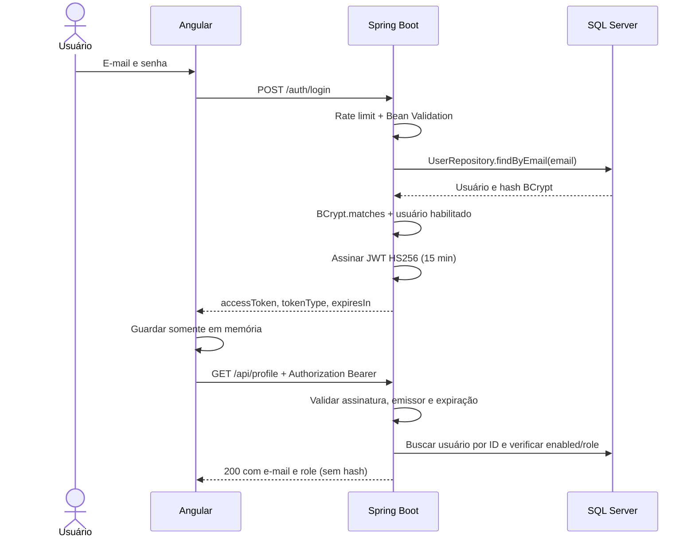

# Atividade 5 — Login Angular + Spring Boot JWT

## Objetivo

Evoluir a tela Angular da Atividade 4 com autenticação no servidor: e-mail/senha no login, BCrypt para comparação e JWT Bearer nas requisições seguintes. O Angular original permanece na raiz; o backend fica em `backend/`.

## Arquitetura

Angular standalone → HTTP → Spring Security / Spring Boot → JPA → SQL Server.



## Tecnologias

Angular 22.1.6 standalone, Angular CLI/build 22.1.8, TypeScript 6.0.3, RxJS 7.8.2; Java com alvo 21, Spring Boot 3.5.16, Spring Security, Web, JPA, Validation, BCrypt custo 12, JJWT 0.12.6, driver JDBC Microsoft e Flyway com módulo SQL Server. Maven Wrapper 3.3.4 / Maven 3.9.11.

## Pré-requisitos

- Node compatível com o lockfile: `^22.22.3 || ^24.15.0 || >=26.0.0`; foi usado Node 24.15.0 / npm 11.12.1.
- JDK 21 recomendado e JAVA_HOME correto. Compilação/testes desta entrega usaram JDK 23.0.2 com `release 21`; execução no JDK 21 ainda não foi verificada.
- SQL Server acessível por TCP com autenticação SQL e banco `atividade5`, ou Docker com Compose.
- Internet no primeiro uso do npm/Maven. Maven global não é necessário.

## Configuração

O backend exige as variáveis abaixo. `.env.example` é apenas um modelo sem credenciais. **Spring Boot não lê .env automaticamente**; configure o ambiente do terminal/IDE que inicia o Java. Compose lê `.env` ou o ambiente do terminal.

Nunca coloque segredos no Angular, Git, screenshots da apresentação ou logs. Não há senha padrão utilizável.

## Variáveis de ambiente

| Variável | Obrigatória / padrão | Finalidade |
|---|---|---|
| DB_URL | Obrigatória | URL JDBC SQL Server |
| DB_USERNAME | Obrigatória | Usuário SQL |
| DB_PASSWORD | Obrigatória | Senha SQL |
| JWT_SECRET | Obrigatória | Base64 de pelo menos 32 bytes aleatórios |
| JWT_TTL_SECONDS | 900; permitido 60–3600 | Validade do Access Token |
| CORS_ALLOWED_ORIGIN | http://localhost:4200 | Uma origem permitida |
| LOGIN_RATE_LIMIT | 10; permitido 1–100 | Tentativas por IP numa janela de 60 s |
| PORT | 8080 | Porta da API |
| MSSQL_SA_PASSWORD | Obrigatória para Compose | Senha do SQL Server local |
| DEMO_USER_ENABLED | false | Habilita criação inicial do usuário |
| DEMO_USER_EMAIL | Obrigatória quando habilitado | E-mail do usuário de demonstração |
| DEMO_USER_PASSWORD | Obrigatória quando habilitado | Senha de demonstração: mínimo 12 caracteres, máximo 72 bytes UTF-8 |

Exemplo PowerShell **na raiz**, solicitando senhas sem imprimi-las:

```powershell
$env:DB_URL = 'jdbc:sqlserver://localhost:1433;databaseName=atividade5;encrypt=true;trustServerCertificate=true;loginTimeout=5;socketTimeout=10000'
$env:DB_USERNAME = 'sa'
$env:MSSQL_SA_PASSWORD = [System.Net.NetworkCredential]::new('', (Read-Host 'Senha forte do SQL Server local' -AsSecureString)).Password
$env:DB_PASSWORD = $env:MSSQL_SA_PASSWORD
$jwtBytes = [byte[]]::new(32)
$rng = [System.Security.Cryptography.RandomNumberGenerator]::Create()
try { $rng.GetBytes($jwtBytes) } finally { $rng.Dispose() }
$env:JWT_SECRET = [Convert]::ToBase64String($jwtBytes)
$env:DEMO_USER_ENABLED = 'true'
$env:DEMO_USER_EMAIL = 'aluno@example.com'
$env:DEMO_USER_PASSWORD = [System.Net.NetworkCredential]::new('', (Read-Host 'Senha acadêmica do usuário (mínimo 12 caracteres)' -AsSecureString)).Password
```

As variáveis valem para esse terminal e seus filhos. Uma nova chave invalida tokens antigos. O exemplo usa `sa` exclusivamente para facilitar o laboratório local; em outro ambiente, crie usuário de privilégio mínimo, separe a credencial de migrations e use certificado confiável com `trustServerCertificate=false`.

## SQL Server

A migration `backend/src/main/resources/db/migration/V1__create_users.sql` cria `app_users`. Flyway executa migrations no startup; Hibernate usa `ddl-auto=validate`, sem criar/alterar tabelas automaticamente.

O banco precisa existir antes do Spring iniciar. No Compose, o serviço `db-init` cria `atividade5` após o healthcheck. O volume mantém os dados. Mudar a variável de senha não troca automaticamente a senha de uma instância já inicializada.

## Como iniciar banco

Com as variáveis configuradas:

```powershell
docker compose up -d sqlserver
docker compose run --rm db-init
docker compose ps
```

A imagem é SQL Server 2022 Developer (uso de desenvolvimento), exposta apenas em `127.0.0.1:1433`. A configuração aceita a EULA da imagem. Não use uma segunda instância nessa porta se outro SQL Server já a estiver usando.

Sem Docker: use uma instância SQL Server local com TCP/IP e autenticação SQL configurados. Crie apenas o banco vazio `atividade5` via SSMS; as tabelas serão criadas pelo Flyway. Ajuste a URL, porta e credenciais. Alterações em protocolos/autenticação da instalação local não são feitas por este projeto.

## Como iniciar backend

No terminal que contém as variáveis, a partir da raiz:

```powershell
cd backend
.\mvnw.cmd spring-boot:run
```

Alternativa a partir da raiz: `backend\mvnw.cmd -f backend\pom.xml spring-boot:run`. Linux/macOS: `cd backend && sh mvnw spring-boot:run`.

Pool Hikari: espera de conexão 5 s, validação 3 s, máximo 5 conexões. Timeout JPA 5 s; URL de exemplo: login JDBC 5 s e socket 10 s. Esses valores são limites distintos, não um prazo global de toda a requisição.

## Como iniciar Angular

Em outro terminal, na raiz:

```powershell
npm ci
npm start
```

Abra `http://localhost:4200`. A API está configurada em `src/app/auth/api.config.ts`; ajuste essa URL antes de um build destinado a outro ambiente. Em produção, use HTTPS em ambos.

## Usuário de demonstração

O initializer só roda quando `DEMO_USER_ENABLED=true`. Normaliza o e-mail para minúsculas, grava BCrypt e role USER se o e-mail ainda não existir. Não sobrescreve senha de usuário existente. Desabilite o initializer e remova a variável de senha do ambiente após a primeira inicialização.

Use o e-mail e a senha que você escolheu no terminal. Não há cadastro nem recuperação de senha nesta atividade.

## Endpoints

| Método | Endpoint | Autenticação | Função |
|---|---|---|---|
| POST | /auth/login | Público, limitado por IP | Receber e-mail/senha e gerar JWT |
| GET | /api/profile | Bearer válido e ROLE_USER | Retornar e-mail e role |

Outras rotas são negadas. Preflight CORS é processado pelo Spring Security.

Entrada: `{"email":"aluno@example.com","password":"<senha escolhida>"}`.

Saída: `{"accessToken":"<JWT>","tokenType":"Bearer","expiresIn":900}`.

Erros JSON: `{"status":401,"message":"Email ou senha inválidos."}`. 400 = entrada inválida; 401 = autenticação ausente/inválida; 403 = autenticado sem permissão (ou origem CORS rejeitada); 429 = limite excedido, com `Retry-After`; 500 = erro interno genérico.

## Autenticação

O login usa a senha uma vez por tentativa. O token contém somente `iss`, `sub` (ID do usuário), `iat` e `exp`. É **assinado, não criptografado**. A assinatura HS256 usa segredo do ambiente; o filtro exige emissor correto, assinatura, expiração, ID e usuário habilitado. A role vem do banco a cada requisição, não do frontend.

O Angular guarda o token somente em memória. Reload ou fechamento da aba exigem novo login. O interceptor só anexa Bearer a caminhos `/api/` da origem exata configurada; não envia token no login ou a outros servidores. Guard melhora navegação e não protege a API.

Após 15 minutos, o Angular limpa o token e volta ao login; a API retorna 401 para tokens expirados independentemente do frontend. Logout limpa a memória; não revoga cópias de tokens já emitidos.

## Segurança

- BCrypt custo 12; limite de senha de 72 **bytes UTF-8**, respeitando BCrypt.
- Entrada validada no frontend e novamente com Bean Validation no backend.
- Login genérico para usuário inexistente, senha incorreta ou usuário desabilitado; comparação com hash fictício quando o e-mail não existe reduz diferença de tempo.
- JPA usa parâmetros, sem concatenar entrada em SQL.
- 10 tentativas por IP / 60 s, incluindo tentativas inválidas e bem-sucedidas. Janela fixa em memória, máximo 10.000 IPs ativos, 429 ao exceder. Sem bloqueio permanente; reiniciar limpa o limite. Proxy/NAT e múltiplas instâncias exigiriam outra estratégia.
- Duplo submit bloqueado no componente e botão desabilitado; timeout RxJS de 10 s no login e perfil. Não cancela necessariamente trabalho já iniciado no servidor.
- CORS restrito a uma origem, sem credenciais de cookie. Não impede Postman/curl.
- CSRF desabilitado porque não há cookie/sessão de autenticação enviada automaticamente pelo navegador; o Bearer é anexado explicitamente. Se cookies forem introduzidos, revisar essa decisão.
- Headers padrão do Spring Security preservados; erros sem detalhes internos. Não há logs de senha, hash ou JWT no código da aplicação.
- Memória reduz persistência do token, mas XSS ainda pode agir em nome do usuário. Não é proteção total contra scripts maliciosos.
- Não há refresh token, revogação por logout, TLS configurado no servidor de desenvolvimento, MFA ou proteção distribuída.

## Testes

```powershell
npm ci
npm run build
cd backend
.\mvnw.cmd test
.\mvnw.cmd package
```

Estado da verificação em 28/09/2026:

- Build Angular: aprovado.
- Backend: compilado com alvo Java 21; testes e empacotamento aprovados.
- 25 testes automatizados: controllers, cadeia Security, BCrypt e JWT reais; UserRepository simulado. Sem H2.
- Migration SQL executada com sucesso no SQL Server local em banco temporário isolado, removido ao final.
- Integração Flyway/JPA via JDBC, initializer com persistência real, navegador com API real e Compose: ainda não verificados. Docker indisponível e sem conexão TCP em localhost:1433 no ambiente inspecionado.
- Aviso da JVM sobre compartilhamento de classes aparece com o agente de testes Mockito; não representa falha de teste.
- Sem suíte frontend adicionada; build e roteiro manual abaixo.

### Validação manual pendente

1. Configure/inicie SQL Server e crie o banco vazio; depois inicie backend e Angular.
2. Confirme Flyway concluído e usuário criado; consulte `SELECT id, email, role, enabled, LEN(password_hash) AS hash_length FROM app_users;`. Para mostrar BCrypt, exiba apenas o prefixo `LEFT(password_hash, 7)`.
3. Abra login e envie campos vazios, e-mail inválido e senha incorreta. Verifique mensagens e 401 no caso de credenciais erradas.
4. Entre com as credenciais escolhidas. Em Network, confira a estrutura da resposta JWT sem compartilhar o token.
5. Veja `GET /api/profile` com `Authorization: Bearer` e 200. A senha não deve ser reenviada.
6. Use “Atualizar perfil” e “Sair”; tente abrir `/perfil` sem login e após reload.
7. Em cliente HTTP, chame `GET http://localhost:8080/api/profile` sem Authorization, com `Bearer invalido` e com token expirado: espere 401.
8. Para expiração rápida, reinicie a API com `JWT_TTL_SECONDS=60`, faça novo login e aguarde. Restaure 900 depois.
9. Opcional: envie 11 POSTs a `/auth/login` do mesmo IP em menos de um minuto, inclusive payload `{}`; após 10 tentativas, espere 429. Aguarde a janela para prosseguir.
10. Pare a API e tente login: mensagem de indisponibilidade, botão reabilitado. Timeout aparece se a conexão ficar pendente por 10 s.

## Estrutura do projeto

```text
src/app/
  app.config.ts / app.routes.ts
  auth/       AuthService, interceptor, guard e URL da API
  login/      Tela original evoluída
  profile/    Demonstração de acesso protegido
backend/
  pom.xml / mvnw / mvnw.cmd / .mvn/
  src/main/java/br/uesc/login/
    config/ controller/ dto/ entity/ exception/ repository/ security/ service/
  src/main/resources/
    application.properties
    db/migration/V1__create_users.sql
  src/test/java/br/uesc/login/
docker-compose.yml / .env.example
README.md / FUNCIONALIDADES_IMPLEMENTADAS.md / GUIA_APRESENTACAO.md
```

## Observações

Nenhuma dependência frontend existente foi atualizada: apenas `@angular/router@22.1.6` foi adicionado, com atualização correspondente do lockfile. Os botões “Esqueci a senha” e “Criar conta” foram preservados visualmente e desabilitados por estarem fora do escopo.

Leia [Funcionalidades implementadas](FUNCIONALIDADES_IMPLEMENTADAS.md) para o relatório e [Guia de apresentação](GUIA_APRESENTACAO.md) para preparar slides e demonstração. Não foram criados slides nem publicado o repositório nesta implementação.

Referências oficiais usadas: [Angular HttpClient](https://angular.dev/api/common/http/provideHttpClient), [Spring Boot 3.5](https://docs.spring.io/spring-boot/3.5/system-requirements.html), [JJWT](https://github.com/jwtk/jjwt), [SQL Server Docker](https://learn.microsoft.com/en-us/sql/linux/quickstart-install-connect-docker?view=sql-server-ver17), [Flyway SQL Server](https://documentation.red-gate.com/fd/sql-server-database-277579330.html).
